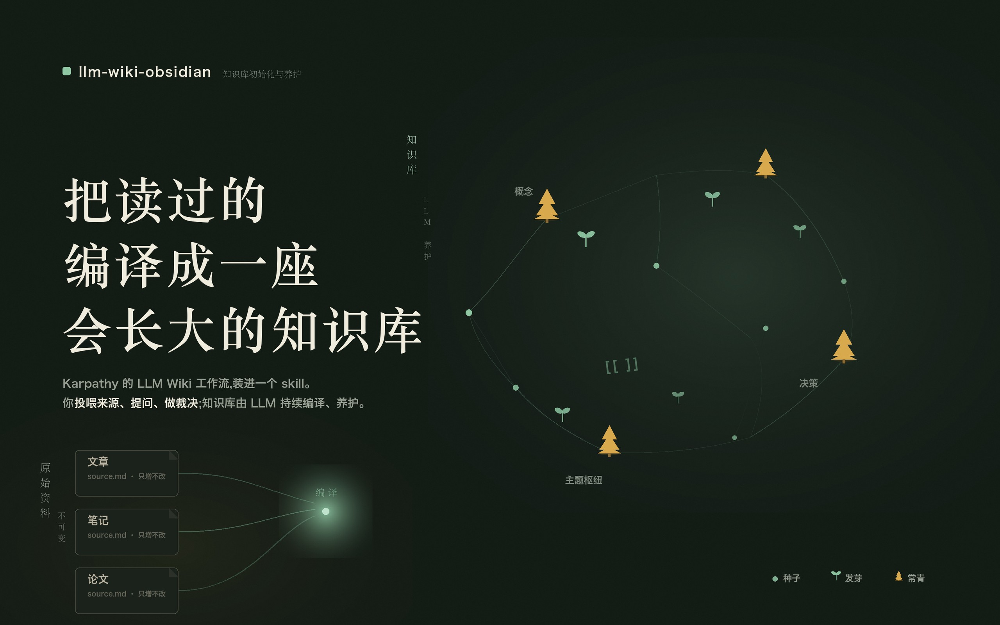

# llm-wiki-obsidian



按 **Andrej Karpathy 的 LLM Wiki 工作流**初始化并维护个人主题知识库的 Claude/Agent 技能——LLM 增量编译、交叉引用、持续维护,Obsidian 看图谱与反链,**承重事实全程可溯源**。

> **不做 RAG 式每次检索,而是让 LLM 把读过的来源持续「编译」成一座结构化、会自我生长的知识库。**
> 你不写知识库,你投喂来源、提问、做裁决;知识库由 LLM 写和维护。

## 核心机制

- **Grounding Invariant**:知识页里每个数字、日期、直接引语,都能在该页 `raw` 字段链接的源文件里**逐字找到**——`工具/证据.py` 全库机械复核,正面防住「幻觉事实被烤成知识」这一 LLM wiki 的头号失效模式。
- **来源保真纪律**:写值前先在原文 locate;原文 42K 就写 42K;推导值展开成分量;找不到就不写精确形式。
- **Triage 四处置**:每篇来源先判定 New / Update / Disputed / No material——无新知只存源记日志,**不硬写文章**。
- **级联更新 + 主张版本**:新源入库后全文检索涟漪效应;被取代的主张标 `Status: Outdated`,冲突标 `Status: Disputed`,**绝不悄悄改写历史**。
- **脚本维护的唯一索引**:索引与仪表盘的计数由 `索引.py` 机械重建,校验第四项 `索引不一致` 抓死条目/漏条目/计数虚——`0/0/0/0` 收口。
- **懒检测增量清单**:哈希基线(mtime+size 预筛、大文件采样)检出待编译源,一篇不漏。
- **待查问题驱动生长**:每页 `## 待查问题`,校验自动汇总,答完划掉派生新问。

与 [Astro-Han/karpathy-llm-wiki](https://github.com/Astro-Han/karpathy-llm-wiki)(2.5k★)同源同宗:它的 Grounding Invariant 与保真纪律已移植进来,并叠加了脚本化索引对账、增量清单、待查问题聚合、批量模式与全中文约定。

## 安装

```bash
git clone https://github.com/Camelovee/llm-wiki-obsidian.git
ln -s "$(pwd)/llm-wiki-obsidian" ~/.claude/skills/llm-wiki-obsidian
```

或项目内 `.claude/skills/` 建符号链接,仅该项目可用。任何会读 `SKILL.md` 的 agent 适用(Claude Code、Cursor、Codex 等)。

## 使用

- **建库**:「我想按卡帕西那套 LLM Wiki 工作流,初始化一个『分布式系统』知识库」→ `python3 scripts/init_kb.py <路径> --topic "<主题>"`
- **投喂**:「这篇文章存进知识库」(贴链接/贴文字),或直接把文件丢进 `原始资料/<主题>/`
- **编译**:「编译一下知识库」——先出处置判定,再逐篇编译、级联更新、重建索引
- **提问**:直接问;好答案说「存进知识库」即归档成页
- **体检**:「检查知识库」——校验 0/0/0/0 + 证据.py 事实溯源

## 库布局

```
原始资料/<主题>/*.md       # 源层:不可变,带元数据头
知识库/<主题>/<文章>.md     # 知识层:LLM 独占写入
知识库/决策/               # 约定目录:对话决策(Promote 落点)
知识库/索引.md 仪表盘.md 维护日志.md
模板/  工具/{清单.py, 校验.py, 索引.py, 证据.py}
```

## 评测

subagent 对照评测驱动迭代(初始化/编译/体检 × 带/不带技能),用例与现场在 `evals/`。

## 隐私

全流程本地运行:文件在磁盘上,脚本只用 Python 标准库,不上传任何数据。

## 致谢

- 方法论源头:[Andrej Karpathy 的 llm-wiki gist](https://gist.github.com/karpathy/442a6bf555914893e9891c11519de94f)
- Grounding Invariant 与保真纪律移植自 [Astro-Han/karpathy-llm-wiki](https://github.com/Astro-Han/karpathy-llm-wiki)(MIT)
- 灵感现场:`/Users/camel/知识库/AI Agent` —— 第一座实例
